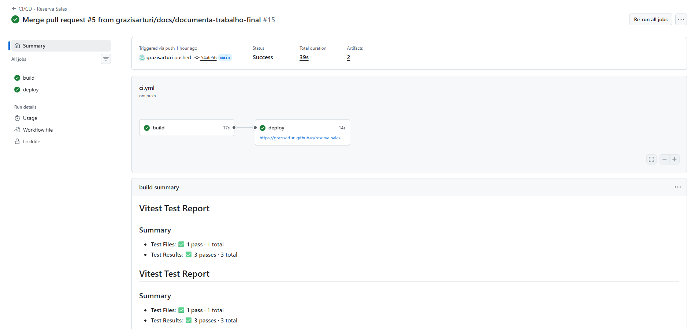
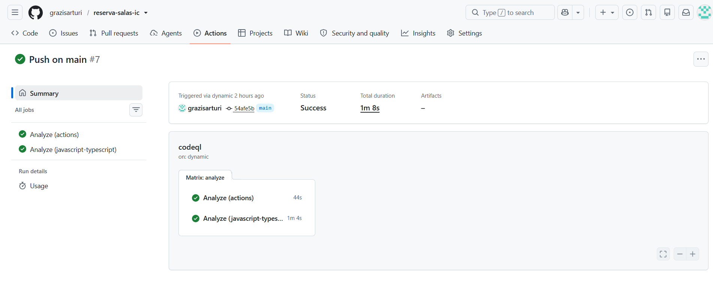
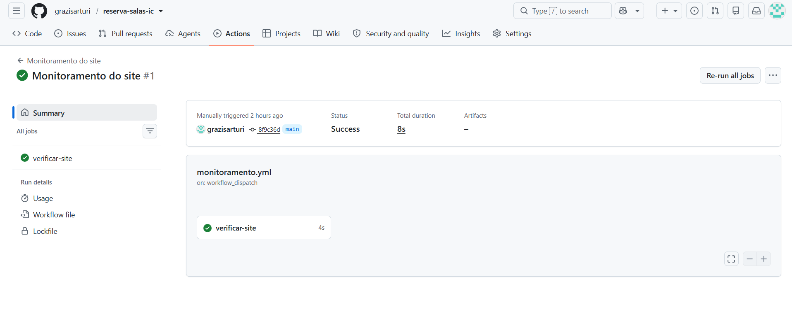
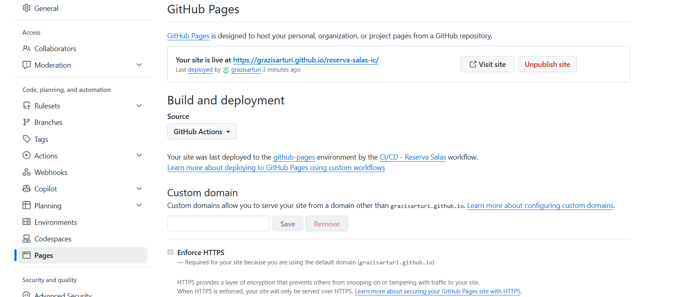
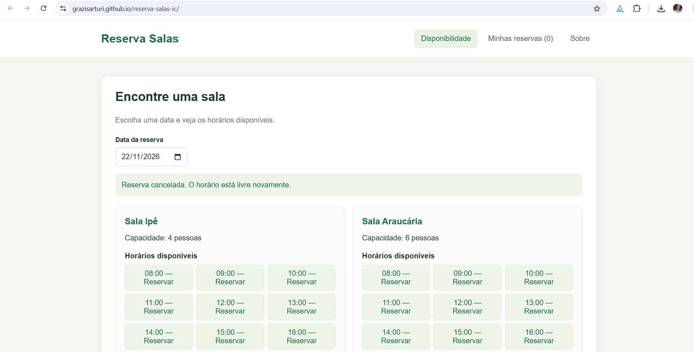

# Reserva Salas

## Sobre o projeto

Reserva Salas é uma aplicação web de página única (SPA) para consultar salas de estudo e organizar reservas. É um protótipo acadêmico com dados fictícios, sem backend; as reservas ficam salvas no navegador.

## Problema que o serviço pretende resolver

Encontrar um espaço livre para estudar pode gerar dúvidas sobre disponibilidade e conflitos de horário. O Reserva Salas reúne as salas e os horários em uma interface para facilitar a consulta e a reserva.

## Público-alvo

Estudantes que procuram um espaço para estudar individualmente ou em grupo.

## Funcionalidades

- Consultar salas e horários por data.
- Reservar um horário disponível de uma hora.
- Impedir reservas em horários passados e conflitos de horário.
- Limitar a duas as reservas futuras salvas neste navegador.
- Consultar e cancelar reservas.
- Salvar as reservas no navegador usando `localStorage`.
- Navegar entre as seções Disponibilidade, Minhas reservas e Sobre.

## Tecnologias utilizadas

- React
- Vite
- JavaScript
- CSS
- `localStorage`
- GitHub Actions

## Possibilidades de monetização

Como possibilidade futura, a aplicação poderia exibir anúncios ou conteúdos patrocinados por cafeterias, papelarias e outros estabelecimentos próximos à universidade. A monetização não está implementada nesta versão.

## Como executar o projeto localmente

É necessário ter Node.js e npm instalados.

1. Abra um terminal na pasta do projeto.
2. Instale as dependências com `npm ci`.
3. Inicie o servidor de desenvolvimento com `npm run dev`.
4. Acesse no navegador o endereço exibido pelo Vite, geralmente `http://localhost:5173/`.

## Integração contínua

O workflow `.github/workflows/ci.yml` é executado automaticamente em pushes para a branch `main` e em Pull Requests direcionados a ela.

As etapas do pipeline são:

1. Baixar o código do repositório.
2. Configurar o Node.js 24.
3. Instalar as dependências com `npm ci`.
4. Verificar vulnerabilidades nas dependências com `npm audit --audit-level=moderate`.
5. Analisar o código com `npm run lint`.
6. Executar os testes automatizados com `npm test`.
7. Gerar o relatório de cobertura com `npm run coverage`.
8. Criar a versão de produção com `npm run build`.
9. Salvar o conteúdo de `dist/` como artefato do workflow.

Uma falha nas validações impede o job de publicação de prosseguir. Para consultar uma execução, acesse a aba **Actions** do repositório e selecione o workflow **CI/CD - Reserva Salas**.

## Qualidade e segurança

O CodeQL analisa o código JavaScript e os arquivos de GitHub Actions. A proteção contra exposição de segredos e a proteção de push estão habilitadas no repositório. Nenhum token pessoal é armazenado no código-fonte.

## Estratégia de branches e Pull Requests

As alterações foram desenvolvidas em branches específicas, como `feature/testes-automatizados`, `fix/atualiza-dependencias` e `feature/deploy-github-pages`. Depois, foram enviadas por Pull Requests para a branch `main`. Os checks do GitHub Actions foram conferidos antes dos merges.

## Artefato de build

O comando `npm run build` gera os arquivos de produção na pasta `dist/`. O workflow salva esse conteúdo como artefato `reserva-salas-dist` e também prepara o artefato usado pelo GitHub Pages. O job de publicação depende do sucesso do job de build.

## Publicação da aplicação

A aplicação é publicada automaticamente no GitHub Pages quando uma alteração é integrada à branch `main` e o pipeline termina com sucesso.

Acesse: https://grazisarturi.github.io/reserva-salas-ic/

## Monitoramento do site

O workflow `.github/workflows/monitoramento.yml` verifica a disponibilidade do site a cada seis horas. A verificação também pode ser iniciada manualmente pela aba **Actions**, usando a opção **Run workflow**.

O job usa `curl` para acessar a página e falha se a requisição HTTP não for bem-sucedida. O histórico das verificações pode ser consultado na aba **Actions**, no workflow **Monitoramento do site**.

## Evidências do trabalho

### Pipeline CI/CD

### Análise do CodeQL

### Monitoramento do site

### GitHub Pages

### Aplicação publicada

